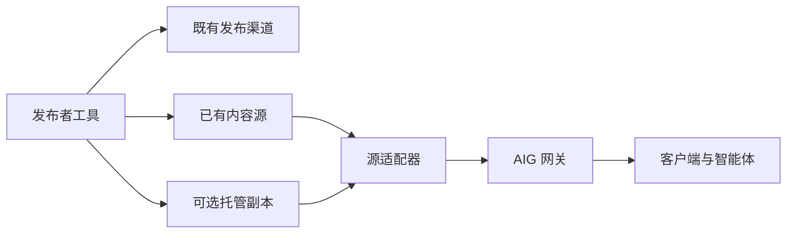

# 架构与实施场景

AIG 是发布者侧网关，将发布者选定的公开内容完整交付给客户端。网关优先复用已有内容源；需要线上副本时，启用可选托管模块。Core 不依赖特定发布者、社交平台或数据库。

目标是发布工具维护同一最终正文，原渠道继续展示内容，已知 AIG 地址的智能体可直接读取来源、版本、更新和撤回。AIG 不改写或总结正文，不评估消费者理解质量。

## 三类实施场景

| 场景 | 谁接入 | 内容存在哪里 | 谁提供公网 |
| --- | --- | --- | --- |
| S1 在第三方平台内发布 | 平台运营方，或具备足够授权接口的适配方 | 原平台 | 平台或获授权的网关运营方 |
| S2 自有发布工具，已有线上源 | 发布者或工具/站点维护者 | 既有网站、CMS、服务器或对象存储 | 发布者或其选定运营方 |
| S3 自有发布工具，仅本地源 | 发布者或工具维护者 | 原本地源，或选定的线上副本 | 维持源可达的运营方，或托管与网关运营方 |

S1 需要实际平台支持或授权接口；公开网页不自动等于可用的 AIG 机器接口。当前实现不依赖 X 等平台原生接入，也不提供平台抓取器。

### S3 的两条路径

| 路径 | 做法 | 可用性边界 |
| --- | --- | --- |
| S3a 保持原源在线可达 | 网关读取原源，不额外保存正文 | 源与网关须在线；文件源参考实现在本地回环使用，公网运行需运营方另行部署 |
| S3b 线上托管副本 | 发布工具主动同步选定公开内容到线上存储 | 本地设备离线后由线上副本服务；更新和撤回必须继续同步 |

维护者实例选择 S3b，不暴露本地数据库或工作目录。托管对通用 Core 可选，对 S3b 的持续在线交付必需。

## 组件边界

| 组件 | 责任 |
| --- | --- |
| 发布者工具 | 决定公开范围，生成最终正文、稳定 ID、连续版本，记录各渠道结果 |
| 源适配器 | 提供目录与按 ID 读取，映射完整正文和状态 |
| AIG Core | 统一 manifest、Feed、详情与错误语义 |
| 可选托管 | 保存已选正文和版本，处理受保护写入、幂等、更新与撤回 |
| 运营方 | 提供 HTTPS、凭据、存储、域名、运行和用量管理 |

参考实现提供本地文件源和 D1 源。已有 CMS 等需要实现相同读取接口，不能将“可扩展”表述为已有任意源连接器。

## 技术路线

TypeScript 与标准 Web API 实现网关；本地 Node 文件服务器用于源适配试用；Workers + D1 是当前公网托管参考路线。D1 不进入通用资源契约。R2 尚未接入。

当前按海外单入口运行。国内部署依据实际读取需求及可达性按需扩展，不因增加国内发布渠道自动建设国内节点；届时复用契约，适配运行与存储。首版无多区域同步。

## 功能与验收边界

先完成发布、保存/源读取、完整交付、更新、撤回，再按实际需求扩展。必要防护包括 HTTPS、独立随机发布凭据与范围检查、基础限速、大小限制和后端存储隔离。

本地回归、指定公网功能、独立网络可达性和真实采用分别验收。工具可用不依赖陌生智能体自动发现或形成标准。当前契约为项目草案，复用 HTTP 和 JSON Feed；后续多方实践决定协议演进。

详见[访问契约](access-contract.md)、[托管模块](hosting-addon.md)与[验证说明](verification.md)。
